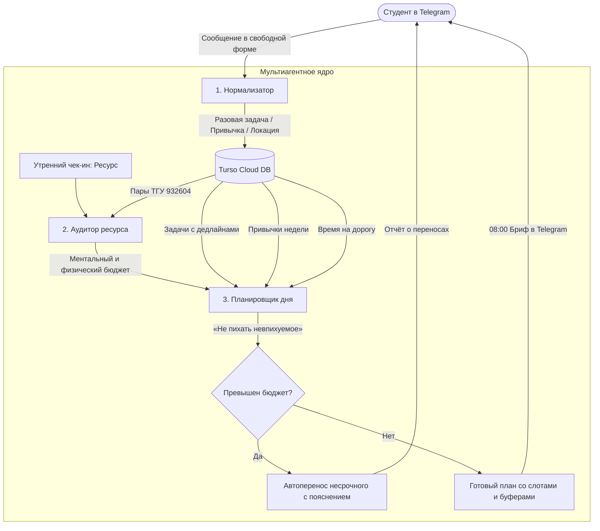

# 🧠 Личный ИИ-планировщик дня с защитой от выгорания (Zero-Cost / Cloud)

Автономный Telegram-бот с мультиагентной системой на Python, который управляет вашим днем.  
Система берет **расписание пар ТГУ (Томский государственный университет) для группы 932604** как жесткий каркас, встраивает личные задачи и регулярные привычки (зал, спорт, курсы), динамически рассчитывает время на логистику и защищает от перегрузок и выгорания, ориентируясь на ваш реальный уровень энергии.

> **💰 100% Бесплатно (0 руб.) и без серверов 24/7:**
> - **Рантайм:** GitHub Actions (запуск по расписанию и вручную)
> - **База данных:** Облачная Turso DB (libSQL / SQLite) на Free Tier (до 9 ГБ и миллиардов чтений)
> - **ИИ-модели:** Google Gemini API (Free Tier через официальный `google-genai` SDK)
> - **Уведомления:** Telegram Bot API (long-polling)

---

## 📑 Оглавление
1. [Архитектура мультиагентной системы](#-архитектура-мультиагентной-системы)
2. [Основные сценарии](#-основные-сценарии)
3. [Быстрый старт за 5 минут](#-быстрый-старт-за-5-минут)
4. [Секреты GitHub Actions](#-секреты-github-actions)
5. [Расписание GitHub Actions (UTC+7)](#-расписание-github-actions-asia-tomsk-utc7)
6. [Команды Telegram-бота](#-команды-telegram-бота)
7. [Структура проекта](#-структура-проекта)
8. [Локальная разработка и тестирование](#-локальная-разработка-и-тестирование)

---

## 🤖 Архитектура мультиагентной системы

В основе системы лежит разделение ответственности между тремя специализированными агентами на базе Gemini:



1. **Нормализатор (Normalizer Agent):**
   - Превращает любые свободные сообщения в структурированные данные.
   - Разделяет разовые задачи (дедлайн, часы) и регулярные привычки (зал $N$ раз в неделю, длительность).
   - Оценивает когнитивную (1–5) и физическую (1–5) сложность.
   - Детектирует новые места (например, «стоматолог» или «новый зал») и инициирует уточнение времени на дорогу.

2. **Аудитор ресурса (Resource Auditor Agent):**
   - Рассчитывает доступный ментальный (0–100) и физический (0–100) бюджет дня.
   - Учитывает утренний чек-ин (`🔋 Высокий`, `😐 Норм`, `🪫 На нуле`).
   - Списывает ментальный ресурс за тяжелые пары (лекции, практики, лабы по программированию).
   - **Правило разгрузки:** физическая тренировка снижает физический бюджет, но проветривает голову. Однако после зала **запрещено** ставить тяжелую учебу (минимум 1.5–2 часа буфера или легкая бытовуха).

3. **Планировщик (Planner Agent):**
   - Берет расписание пар группы **932604** как неподвижный жесткий каркас.
   - Резервирует динамические буферы логистики: дорога туда $\rightarrow$ занятие $\rightarrow$ душ/отдых (после зала) $\rightarrow$ дорога обратно.
   - **Главный принцип антивыгорания:** если сумма задач превышает бюджет дня, агент **не пытается уместить всё**. Он оставляет только критичные задачи с горящими дедлайнами и обязательную норму привычек, а остальное переносит на свободные дни недели с человеческим пояснением.

---

## 🎯 Основные сценарии

### 1. Расписание ТГУ (Группа 932604)
- Автоматически синхронизируется с веб-сервисом расписания ТГУ (`intime.tsu.ru`).
- Встроено надежное локальное кэширование в облачной БД: если сайт вуза недоступен, планировщик работает без сбоев на сохраненном кэше.
- В проект включен готовый стартовый набор пар для группы 932604 (`src/sample_schedule.json`).

### 2. Интерактивный онбординг и динамическая логистика
- Никаких захардкоженных минут на дорогу!
- При первом запуске (`/start`) бот проводит калибровку за 4 вопроса:
  1. Время на дорогу до корпусов ТГУ.
  2. За сколько минут до первой пары выходите из дома.
  3. Комфортное время отхода ко сну.
  4. Время утреннего подъема.
- При появлении в задачах нового места бот сам спрашивает в чате:  
  *«📍 Новая локация — Зал. Сколько минут закладывать на дорогу туда в одну сторону?»*  
  И в дальнейшем автоматически резервирует эти буферы до и после занятий.

### 3. Регулярные привычки (Норма недели)
- Вы говорите: *«мне нужно ходить в зал 3 раза в неделю по 1.5 часа»*.
- Бот резервирует слоты на неделю, обходя пары и дни с пиковой нагрузкой.
- Если тренировку пришлось перенести — бот автоматически сдвинет ее на другой свободный день этой же недели, гарантируя выполнение нормы (3 раза в неделю).

### 4. Утренний бриф (08:00 Tomsk) и вечерний итог (21:30 Tomsk)
- **Утро:** бот присылает план и интерактивные кнопки состояния: `[🔋 Высокий]`, `[😐 Норм]`, `[🪫 На нуле]`. Нажатие мгновенно адаптирует расписание под ваше самочувствие.
- **Вечер:** опрос о закрытых задачах. Незакрытые задачи переносятся без потери дедлайнов.

---

## ⚡ Быстрый старт за 5 минут

### Шаг 1: Создайте Telegram-бота
1. Откройте [@BotFather](https://t.me/BotFather) в Telegram и отправьте команду `/newbot`.
2. Задайте имя и юзернейм бота, сохраните полученный **API токен**.
3. Узнайте свой числовой ID через [@userinfobot](https://t.me/userinfobot) (например, `123456789`).

### Шаг 2: Создайте бесплатную базу данных в Turso
1. Установите CLI Turso (или зарегистрируйтесь на [turso.tech](https://turso.tech)):
   ```bash
   # macOS / Linux:
   curl -sSfL https://get.tur.so/install.sh | bash
   ```
2. Авторизуйтесь и создайте БД:
   ```bash
   turso auth login
   turso db create day-planner
   ```
3. Скопируйте URL базы и создайте токен:
   ```bash
   turso db show day-planner --url
   # Выведет: libsql://day-planner-[username].turso.io (это TURSO_DATABASE_URL)

   turso db tokens create day-planner
   # Выведет длинную строку токена (это TURSO_AUTH_TOKEN)
   ```

### Шаг 3: Получите бесплатный ключ Gemini API
1. Перейдите на [Google AI Studio](https://aistudio.google.com/).
2. Нажмите **Get API Key** $\rightarrow$ **Create API Key**.
3. Скопируйте ключ (`GEMINI_API_KEY`).

### Шаг 4: Загрузите код на GitHub и настройте Secrets
1. Создайте новый приватный или публичный репозиторий на GitHub и загрузите в него код:
   ```bash
   git init
   git add .
   git commit -m "feat: initial day planner bot setup"
   git remote add origin https://github.com/ВАШ_АККАУНТ/ВАШ_РЕПОЗИТОРИЙ.git
   git branch -M main
   git push -u origin main
   ```
2. В репозитории на GitHub перейдите в **Settings** $\rightarrow$ **Secrets and variables** $\rightarrow$ **Actions** $\rightarrow$ **New repository secret** и добавьте 5 секретов:

| Секрет | Откуда взять | Описание |
| :--- | :--- | :--- |
| `TELEGRAM_BOT_TOKEN` | @BotFather | Токен вашего бота |
| `TELEGRAM_USER_ID` | @userinfobot | Числовой ID вашего Telegram-аккаунта (защита от чужих) |
| `GEMINI_API_KEY` | Google AI Studio | Бесплатный ключ Gemini API |
| `TURSO_DATABASE_URL` | `turso db show --url` | `libsql://day-planner-...turso.io` |
| `TURSO_AUTH_TOKEN` | `turso db tokens create` | Токен авторизации Turso |

### Шаг 5: Инициализируйте БД в GitHub Actions
1. Во вкладке **Actions** в репозитории выберите воркфлоу **Initialize Database**.
2. Нажмите кнопку **Run workflow** $\rightarrow$ **Run workflow**.
3. За 10–15 секунд создадутся таблицы и загрузится базовое расписание для группы 932604!

### Шаг 6: Запустите бота
1. Откройте созданного бота в Telegram и отправьте `/start`.
2. Ответьте на 4 вопроса онбординга (время на дорогу, подъем, сон).
3. Готово! Теперь вы можете надиктовывать или писать любые задачи!

---

## ⏰ Расписание GitHub Actions (Asia/Tomsk, UTC+7)

Все кроны в GitHub Actions работают по времени **UTC**. Мы точно рассчитали разницу с часовым поясом Томска (UTC+7):

| Воркфлоу | Время в Томске (UTC+7) | Крон UTC в GitHub Actions | Что делает |
| :--- | :--- | :--- | :--- |
| **`poll.yml`** | Каждые 15 минут | `*/15 * * * *` | Забирает новые сообщения из Telegram, обрабатывает задачи |
| **`morning.yml`** | **08:00** ежедневно | `0 1 * * *` *(01:00 UTC)* | Присылает план дня и кнопки замера ресурса |
| **`evening.yml`** | **21:30** ежедневно | `30 14 * * *` *(14:30 UTC)* | Подводит итоги дня, переносит хвосты |
| **`update_schedule.yml`**| **06:00** каждый понедельник | `0 23 * * 0` *(Вс 23:00 UTC)* | Обновляет расписание пар ТГУ с сайта вуза |

> **Ручной запуск:** Любой воркфлоу можно в любой момент запустить вручную через кнопку `Run workflow` во вкладке GitHub Actions.

---

## 💬 Команды Telegram-бота

Вы можете общаться с ботом как командами, так и естественным человеческим языком:

| Команда | Что делает |
| :--- | :--- |
| `/start` | Запуск первичного онбординга или приветствие |
| `/plan` или `/today` | Показать расписание пар и запланированные задачи на сегодня |
| `/week` | Обзор всей недели со статистикой выполнения |
| `/tasks` | Список всех активных задач с дедлайнами и оценкой сложности |
| `/habits` | Список всех регулярных привычек (зал, бассейн, чтение) |
| `/done <название>` | Отметить задачу или привычку выполненной |
| `/help` | Краткая справка по возможностям |

### Примеры естественных запросов:
- *«Сделать лабу по си до пятницы, сложная, часа на 3»* $\rightarrow$ создаст задачу с cognitive load 4/5 и дедлайном.
- *«Надо ходить в зал 3 раза в неделю по 1.5 часа по вечерам»* $\rightarrow$ создаст привычку, спросит дорогу до зала и распределит по дням.
- *«Сходить к зубному во вторник в 15:00»* $\rightarrow$ спросит время на дорогу и забронирует слот с буферами.
- *«Отметь лабу по си»* $\rightarrow$ агент сам поймет намерение и закроет задачу.

---

## 📂 Структура проекта

```
day-planner-bot/
├── .github/
│   └── workflows/
│       ├── poll.yml             # Проверка сообщений каждые 15 минут
│       ├── morning.yml          # Утренний бриф в 08:00 Tomsk
│       ├── evening.yml          # Вечерний итог в 21:30 Tomsk
│       ├── update_schedule.yml  # Еженедельное обновление пар ТГУ
│       └── init_db.yml          # Первичная инициализация схемы БД
├── src/
│   ├── __init__.py
│   ├── __main__.py              # Главная CLI точка входа для GitHub Actions
│   ├── config.py                # Загрузка переменных окружения и таймзоны
│   ├── db.py                    # Драйвер Turso (libsql) с локальным SQLite fallback
│   ├── models.py                # Dataclasses для задач, привычек, расписания
│   ├── telegram.py              # Асинхронный клиент Telegram Bot API
│   ├── tsu_parser.py            # Парсер расписания ТГУ (intime.tsu.ru) с кэшированием
│   ├── utils.py                 # Расчет буферов, окон времени, таймзона UTC+7
│   ├── onboarding.py            # Интерактивный диалог калибровки и опрос о локациях
│   ├── sample_schedule.json     # Стартовое расписание группы 932604
│   ├── agents/
│   │   ├── __init__.py
│   │   ├── base.py              # Клиент Google Gemini SDK с авто-парсингом JSON
│   │   ├── normalizer.py        # Агент 1: структурирование свободного текста
│   │   ├── auditor.py           # Агент 2: аудит ментального/физического бюджета
│   │   └── planner.py           # Агент 3: планирование и защита от выгорания
│   └── commands/
│       ├── __init__.py
│       ├── poll.py              # Обработка входящих апдейтов и колбэков кнопок
│       ├── morning.py           # Логика генерации утреннего плана
│       └── evening.py           # Логика вечернего ревью и автопереноса
├── tests/
│   ├── test_smoke.py            # Базовые смоук-тесты схемы, утилит и моделей
│   └── test_logic.py            # Тесты конечного автомата онбординга и буферов
├── schema.sql                   # SQL-схема всех таблиц
├── requirements.txt             # Зависимости Python
├── .env.example                 # Шаблон для локальной разработки
├── .gitignore
└── README.md
```

---

## 🛠 Локальная разработка и тестирование

Если вы хотите запустить или протестировать бота локально:

1. Клонируйте репозиторий и создайте виртуальное окружение:
   ```bash
   python3 -m venv venv
   source venv/bin/activate  # на Windows: venv\Scripts\activate
   pip install -r requirements.txt
   ```

2. Создайте файл `.env` на основе шаблона `.env.example`:
   ```bash
   cp .env.example .env
   # Заполните ваши ключи
   ```

3. Запустите автоматические тесты:
   ```bash
   python3 tests/test_smoke.py
   python3 tests/test_logic.py
   ```

4. Полезные CLI-команды:
   ```bash
   # Проверить статус системы и базы данных
   python -m src status

   # Инициализировать схему БД
   python -m src init

   # Импортировать расписание для группы 932604
   python -m src seed

   # Запустить одиночный опрос сообщений Telegram
   python -m src poll

   # Протестировать отправку утреннего брифа
   python -m src morning

   # Протестировать вечерний итог
   python -m src evening
   ```

---

## 🛡 Безопасность
- Бот проверяет входящий `TELEGRAM_USER_ID` для каждого входящего сообщения и нажатия кнопок. Сообщения от любых посторонних пользователей автоматически отбрасываются и логируются.
- Никакие токены, ключи API или идентификаторы не хранятся в кодовой базе — они передаются только через переменные окружения и GitHub Secrets.
